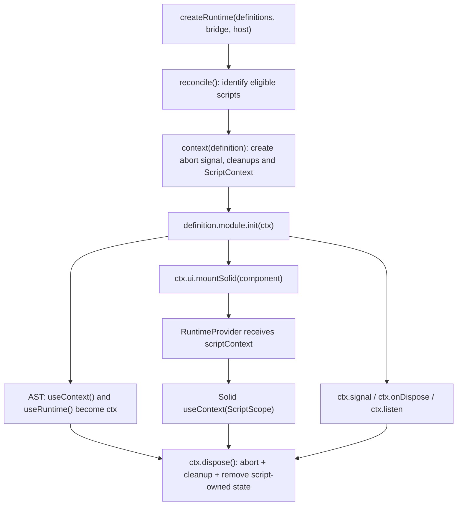

# Contexto de execução e estratégia de otimização

> Estado documentado: PR #56, branch `feat/modular-runtime-tree-shaking`. Este documento distingue comportamento implementado, garantias testadas e trabalho planejado.


## Runtime context lifecycle: source of truth

The **userscript instance** owns its context. No module, page, or mutable global variable owns the active context.



### Where the value is assigned

1. `src/core/runtime.ts`: `createRuntime(...)` initializes the runtime and its definitions.
2. `reconcile()` calls `context(definition)` for **each eligible script instance**. This creates a fresh `AbortController`, cleanup list and the actual `const scriptContext: ScriptContext = { ... }`.
3. The context factory returns that object, then `reconcile()` calls `await definition.module.init(ctx)`. This is the explicit ownership boundary.
4. **Compile-time path:** `build/runtime-helpers.mjs` rewrites unshadowed, zero-argument `useContext()` and `useRuntime()` calls inside lexically bound `init(ctx)` scopes to the local `ctx`; `useRuntimeWorld()` becomes `ctx.events.shared`. Destructuring, aliases and nested callbacks can close over that same local binding.
5. **Solid path:** `ctx.ui.mountSolid` wraps the component in `RuntimeProvider`, passing the **same** `scriptContext`. `src/core/runtime-context.ts` reads it through Solid's context/owner tree.
6. When the script stops matching or the runtime closes, `ctx.dispose()` aborts the signal, runs registered cleanup callbacks, and removes instance-owned state. A later activation receives a **new** context.

```ts
export default {
  init(ctx: ScriptContext) {
    const { storage, menu: actions } = useContext(); // compiled to: const { storage, menu: actions } = ctx
    const { signal } = useRuntime();                  // compiled to: const { signal } = ctx
    const shared = useRuntimeWorld();                 // compiled to: ctx.events.shared
    const callback = async () => useContext().storage; // closes over this instance's ctx
    ctx.onDispose(() => { /* release script-owned resources */ });
  },
};
```

### Important limits and safe shared modules

The AST **does not automatically inject context into arbitrary imported modules**. Module-top-level `useContext()` is ambiguous when two scripts import the same module. Do not create a mutable `currentContext` global or silently bind to the last initialized script. Pass the context explicitly to a shared factory:

```ts
// shared/bookmarks.ts
export function createBookmarks(ctx: ScriptContext) {
  return { save: (item: string) => ctx.storage.set("bookmark", item) };
}

// userscript entrypoint
init(ctx: ScriptContext) {
  const bookmarks = createBookmarks(ctx);
  ctx.onDispose(() => { /* release instance-owned resources */ });
}
```

Solid's provider only propagates through its owner tree, not arbitrary async callbacks; `bindRuntime(ctx)` explicitly binds helpers where needed. `useRuntimeWorld()` currently refers to **cross-script shared events**, not page/sandbox execution-world selection. Shared events must never expose other scripts' private stores.

### Documentation and verification contract

**Every future change** to `ScriptContext`, `context(definition)`, `reconcile()`, AST helper resolution, `RuntimeProvider`, UI mounting or disposal must update **this guide and its diagram in the same work block**. Update real examples, limitations, tests (`tests/runtime-helpers.test.js` and lifecycle tests), and interactive Playground demos for new user-visible behavior. Run relevant tests, typecheck and build; report CI failures accurately. Register stores, styles, listeners and observers inside the owning context, never in a shared global singleton.

## 1. Arquitetura e fronteiras

```text
userscripts.config.js
    │ definições: id, entry, matches, exclude, world, grants, requires
    ▼
build/runtime-graph.mjs ──► build/runtime-usage.mjs
    │ imports transitivos         │ acessos ctx.* e casos dinâmicos
    └──────────────┬──────────────┘
                   ▼
build/bundle-runtime.mjs
    │ defines __ROD_FEATURE_* por target e world
    ▼
Vite 8 / Rolldown → runtime + módulos de cada target
    ▼
build/build.mjs → instalável .user.js + .js legível
    └─► dist/runtime-feature-audit.json
```

A entrada de cada script exporta um módulo com `init(ctx)`. `createRuntime(definitions, bridge, host)` cria o roteador e expõe `{ ready, navigate, active, dispose }`. Há dois mundos de execução, `sandbox` e `page`, empacotados separadamente quando necessário. O build envolve os bundles nos instaladores correspondentes; não se deve presumir que APIs, permissões e objetos globais atravessam os mundos sem bridge.

O `standalone` inclui todos os scripts e instala o Dock no sandbox. Cada instalável individual inclui apenas a definição selecionada. O target `unified` agrega os scripts com `unified !== false`. As permissões Tampermonkey `@grant`, `@require` e `@connect` são agregadas por target. Regras `exclude` por módulo permanecem no roteador; um `@exclude` global em um instalável com vários módulos poderia bloquear módulos válidos.

## 2. Ciclo de vida

1. `createRuntime` configura serviços compartilhados (menu, toaster, storage, clipboard conforme flags), listeners de navegação e regras do Script Manager.
2. `ready` chama `navigate()`; o reconciliador compara a URL com `matches` e regras persistidas.
3. Para cada módulo permitido e ainda inativo, cria `ctx` com `AbortController`, event bus, eventos compartilhados, estado, callbacks de cleanup e APIs.
4. Executa `await module.init(ctx)`. Se retornar uma função, ela é registrada em `ctx.onDispose`. Se a URL mudar durante a inicialização, o contexto obsoleto é descartado.
5. `pushState`, `replaceState`, `popstate`, `hashchange`, alterações de storage e eventos do Script Manager solicitam reconciliação. O agendamento consolida chamadas concorrentes.
6. Ao sair de uma URL permitida, `ctx.dispose()` aborta o sinal, executa callbacks em ordem inversa, desmonta UI, remove estilos/listeners e limpa estado e inscrições.
7. `api.dispose()` encerra o roteador, restaura métodos de history quando ainda são seus wrappers, remove listeners globais, encerra clipboard, stores e bridge.

Falhas de inicialização são registradas por URL para evitar tentativas repetidas na mesma navegação; não confundir com retry automático.

## 3. Contrato de `ctx`

| API                                             | Comportamento atual                                             | Limpeza/observação                                                                                           |
| ----------------------------------------------- | --------------------------------------------------------------- | ------------------------------------------------------------------------------------------------------------ |
| `id`, `url`, `signal`                           | Identidade, URL atual (getter) e `AbortSignal`                  | Signal abortado no dispose                                                                                   |
| `onDispose(fn)`, `dispose()`                    | Registro explícito e descarte                                   | Callbacks em ordem inversa                                                                                   |
| `listen(target, event, fn, options)`            | Listener com sinal do contexto                                  | Abort remove listener                                                                                        |
| `events`                                        | Event bus por namespace, `shared` e `dom`                       | `events.dom` deduplica por target/tipo/callback/capture e remove no dispose                                  |
| `state.get/set/subscribe`                       | Estado em memória por ID                                        | Subscriptions e estado removidos no dispose                                                                  |
| `storage.get/set/delete`                        | Persistência namespaced, bridge legada como fallback de leitura | Store criado **sob demanda** na primeira operação; reutilizado entre entradas SPA; fechado no dispose global |
| `db(name, options)`                             | Instância de storage IndexedDB namespaced por nome              | Cache por contexto; fecha no dispose do contexto                                                             |
| `gm`                                            | Bridge de APIs GM                                               | Incluída apenas se feature GM habilitada                                                                     |
| `http`, `interceptRequest`, `interceptResponse` | Cliente HTTP e interceptadores                                  | Interceptadores e cliente descartados com contexto                                                           |
| `dom`                                           | DOM engine                                                      | Descartado com contexto                                                                                      |
| `menu`, `toaster`                               | Menu Solid e RodToaster                                         | Dependências opcionais de build; `menu` pode ser necessário ao clipboard                                     |
| `clipboard`                                     | Histórico, ações e abertura de menu                             | Gerenciado pelo runtime global                                                                               |
| `dock.register(actions)`                        | Emite eventos de registro/desregistro                           | Desregistro no dispose                                                                                       |
| `ui.root/host/mount/style`                      | Host fixo com ShadowRoot aberto, criado no primeiro uso         | Remove host e estilos                                                                                        |
| `ui.registerStyles/mountSolid`                  | Helpers Solid/CSS para ShadowRoot                               | Exigem feature UI habilitada; registram cleanup                                                              |
| `style(css)`, `pageStyle(css)`                  | Estilos no ShadowRoot ou documento                              | Removidos no dispose                                                                                         |

**Cuidados:** `ctx.style` não é equivalente a `ctx.pageStyle`; o primeiro isola CSS, o segundo altera o documento hospedeiro. Não acesse o DOM no topo do módulo. Prefira `ctx.listen`, `ctx.events.dom` e `ctx.onDispose` a listeners sem cleanup. O tipo `ScriptContext` ainda expõe propriedades opcionais como não opcionais; ao desativar uma feature, alguns valores podem ser `undefined` ou funções vazias. Isto é uma lacuna de tipagem a corrigir, não uma garantia de disponibilidade.

### Exemplo de módulo

```ts
export default {
  async init(ctx) {
    ctx.style(":host { color: inherit; }");
    const settings = await ctx.storage.get("settings", { enabled: true });
    ctx.state.set(settings);
    ctx.listen(window, "keydown", (event) => {
      if (event.key === "Escape") ctx.state.set({ ...ctx.state.get(), open: false });
    });
    const release = ctx.state.subscribe((next) => console.debug(next));
    ctx.onDispose(release);
    return () => console.debug("encerrado", ctx.id);
  },
};
```

## 4. Como o tree-shaking funciona hoje

`analyzeRuntimeGraph(entry)` percorre imports locais transitivos, reexports e ciclos sem revisitar arquivos; ignora imports de assets como CSS. Inclui `import("literal")` e `require("literal")`. Imports computados sem destino estático forçam fallback conservador. `analyzeRuntimeUsage` usa AST TypeScript, não regex de texto: identifica `ctx.menu`, `ctx["menu"]`, destructuring e aliases transitivos. `ctx[key]`, espalhamento, passagem/retorno do contexto e outros escapes exigem runtime completo.

O bundle usa defines constantes substituídos pelo Vite/Rolldown:

| Define                      | Acesso detectado                                            |
| --------------------------- | ----------------------------------------------------------- |
| `__ROD_FEATURE_MENU__`      | `ctx.menu` **ou** clipboard                                 |
| `__ROD_FEATURE_TOASTER__`   | `ctx.toaster`                                               |
| `__ROD_FEATURE_CLIPBOARD__` | `ctx.clipboard`                                             |
| `__ROD_FEATURE_GM__`        | `ctx.gm`                                                    |
| `__ROD_FEATURE_DOM__`       | `ctx.dom`                                                   |
| `__ROD_FEATURE_UI__`        | `ctx.ui`                                                    |
| `__ROD_FEATURE_HTTP__`      | `ctx.http`, `ctx.interceptRequest`, `ctx.interceptResponse` |

`storage`, `db`, `events`, `state`, roteamento e lifecycle ainda fazem parte do núcleo. `options.dock`, análise dinâmica ou ausência de lista de features habilitam o runtime completo. Consumidores diretos de `createRuntime` mantêm fallback compatível quando os defines não existem. Os módulos de features continuam imports estáticos, mas seus factories ficam sob branches elimináveis: os testes conferem que módulos de feature desabilitados não têm bytes renderizados no grafo do Rolldown.

**Limite importante:** excluir o wrapper de uma feature não prova que uma dependência compartilhada deixou o bundle. Por isso auditamos o grafo real, não apenas as flags. O standalone intencionalmente retém mais funcionalidades; a otimização é especialmente útil para instaláveis individuais.

## 5. Auditoria, medidas e diagnóstico

`dist/runtime-feature-audit.json` contém features e arquivos por script, acessos dinâmicos, módulos de fonte compartilhados, bundles por target/world, módulos renderizados e top modules, bytes/gzip de artefatos e ranking `repeatedRenderedModules`. O console do build exibe maiores módulos e dependências repetidas.

Métricas diferentes não devem ser confundidas:

- `sourceBytes`: tamanho dos arquivos de origem, **não** tamanho do bundle.
- `renderedBytes`: contribuição do módulo informada pelo Rolldown, antes da minificação final; não equivale a bytes transferidos.
- `aggregateRenderedBytes`: soma diagnóstica entre bundles independentes, **não** economia esperada.
- `bytes` e `gzipBytes`: tamanhos efetivos do instalável gerado; estes são os indicadores para comparar antes/depois.
- `debugBytes` e `debugGzipBytes`: versão legível `<id>.js`, sem cabeçalho userscript, útil para inspeção.

O instalável `<id>.user.js` conserva o cabeçalho Tampermonkey e é minificado com Oxc; `<id>.js` é formatado e não minificado. Sourcemaps do standalone estão temporariamente desabilitados, com TODO e requisitos de teste no build.

### Linha de base observada no CI 43755260824

| Target            | Instalável (bytes) | gzip (bytes) |
| ----------------- | -----------------: | -----------: |
| standalone        |          3.081.511 |      729.553 |
| rodx-studio       |          1.384.773 |      300.213 |
| page-repl         |          1.085.621 |      318.404 |
| dom-inspector     |            642.333 |      199.241 |
| mobile-editor-fab |            251.451 |       68.170 |

Maiores módulos renderizados observados: `@codemirror/view` (~307–351 KB nos targets com editor), `acorn` (~181 KB), `src/runtime/vendor/toaster.js` (~174 KB por bundle onde incluído), e `search-workbench.tsx` (~181 KB). Esses números são contribuições **não minificadas** e variam conforme o target.

## 6. Estratégia de otimização, em ordem

### Fase A: segurança e observabilidade (implementada)

- [x] Análise AST de uso do contexto, aliases e escapes.
- [x] Análise transitiva de imports e fallback conservador.
- [x] Flags por target/world e eliminação de features opcionais.
- [x] Testes que verificam o grafo real de módulos renderizados.
- [x] Builds legíveis `.js` e instaláveis minificados `.user.js`.
- [x] Auditoria de bytes/gzip e ranking de dependências repetidas.
- [x] Store persistente inicializado no primeiro uso; teste de regressão adicionado.
- [ ] Confirmar CI do teste mais recente e manter uma linha de base por commit.

### Fase B: remover peso compartilhado (próxima prioridade)

- [ ] Separar o `vendor/toaster.js` monolítico em **core de notificações** e recursos avançados (inspector, histórico, tarefas, persistência, exportação), preservando API e aparência.
- [ ] Fazer recursos avançados opt-in por import explícito ou build feature; evitar que `ctx.toaster` básico inclua tudo.
- [ ] Auditar `RodStorage` monolítico: manter compatibilidade de namespace, fallback GM, IndexedDB, migrações e cleanup antes de dividir adaptadores/transformações.
- [ ] Revisar `menu`, `clipboard` e `ui` para evitar importações transitivas desnecessárias.
- [ ] Comparar **bytes e gzip** por target, registrando diferenças absolutas e percentuais.

### Fase C: editores e funcionalidades grandes

- [ ] Examinar CodeMirror, Lezer e Acorn por target; importar somente linguagens/extensões usadas.
- [ ] Avaliar carregamento sob demanda de ferramentas avançadas, respeitando o requisito de userscript instalável autocontido (sem import remoto, Blob ou eval).
- [ ] Dividir `search-workbench.tsx` e outros módulos grandes por responsabilidade, sem assumir que dividir arquivos por si só reduz o bundle.
- [ ] Evitar duplicação de dependências no mesmo bundle; não prometer deduplicação entre instalações independentes.

### Fase D: runtime e desempenho

- [ ] Medir tempo de bootstrap, tempo até primeira interação, número de listeners e custo de navegação SPA.
- [ ] Avaliar criação sob demanda de outros serviços, sempre com teste de lifecycle.
- [ ] Corrigir tipos opcionais do contexto para refletir as flags.
- [ ] Verificar vazamentos de listeners, observers, stores, ShadowRoots e interceptadores em repetidas entradas/saídas.
- [ ] Validar Safari iPhone/Tampermonkey, Dock, Shadow DOM, clipboard, rede e navegação SPA.

## 7. Critérios de aceite

1. `npm run build`, `npm test` e typecheck passam; falha de CI deve ser investigada antes do merge.
2. Nenhuma feature utilizada desaparece do instalável; acessos dinâmicos seguem fallback conservador.
3. `dist/runtime-feature-audit.json` mostra os módulos retidos por target/world e flags consistentes.
4. Cada otimização de tamanho tem comparação antes/depois em **bytes e gzip**; melhoria não comprovada não deve ser anunciada como redução.
5. `<id>.js` permanece legível, `<id>.user.js` instalável e metadados Tampermonkey intactos.
6. Nenhum recurso de UI perde isolamento, interatividade, teardown ou compatibilidade mobile.
7. Alterações são agrupadas em commits por bloco lógico; antes do merge, sincronizar com `main`, resolver conflitos e repetir CI.

## 8. Referências no repositório

- `src/core/runtime.ts`: contrato e lifecycle do contexto.
- `src/runtime/modular/features/*`: fronteiras de features.
- `build/runtime-usage.mjs`: AST e acesso ao contexto.
- `build/runtime-graph.mjs`: dependências transitivas.
- `build/bundle-runtime.mjs`: defines e Rolldown.
- `build/build.mjs`: targets, instaláveis, auditoria e minificação.
- `tests/runtime.test.js`, `tests/runtime-graph.test.js`, `tests/runtime-inspection-build.test.js`: regressões.
