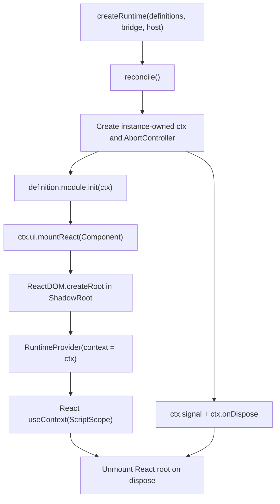

# React-only refactor: migration contract

Status: in progress. **Do not remove Solid or switch production entrypoints until their React replacements pass validation.**

## Non-negotiable target

- React + React DOM + TypeScript for every interactive userscript and shared UI.
- Keep CSS Modules, Shadow DOM isolation, mobile Safari compatibility and the existing shadcn/Vercel visual language.
- Preserve instance-owned `ctx`: `ctx.dom`, `ctx.events`, `ctx.storage`, `ctx.http`, `ctx.ui`, `ctx.signal`, and `ctx.onDispose`.
- `RuntimeProvider` must use the existing `src/core/runtime-context-react.tsx` and must never use a mutable global active context.
- Mount via `createRoot` from `react-dom/client`; unmount every root on `ctx.onDispose`. Expose `ctx.ui.mountReact`, not `mountSolid`.
- `ctx.store` must be framework-neutral and subscribe through `useSyncExternalStore` or an equivalent React adapter. Do not call React hooks outside React components/custom hooks.
- No direct `document.querySelector`, `addEventListener`, raw fetch/XHR interception, or ad hoc global CSS in migrated feature modules when the equivalent `ctx` API exists.

## Migration order

- [ ] Add React 19, React DOM, JSX runtime, typings, compiler configuration, and lockfile changes as one tested unit.
- [ ] Implement `runtime-react`, React ShadowRoot mount, `ctx.ui.mountReact`, context lifecycle tests, and React-only bundle smoke tests.
- [ ] Migrate shared UI primitives: Button, Badge, Dialog, Dropdown, Toast, RodMenu, Dock, clipboard, object inspector, form controls.
- [ ] Migrate Instagram bookmark UI and settings.
- [ ] Migrate Reddit/GoneWild (including audio, player, search, and Soundgasm) without changing page-world behavior.
- [ ] Migrate RodX Studio and Twitter/X UI, retaining interceptors and mobile gesture behavior.
- [ ] Migrate DOM inspector, page REPL, GitHub tools, mobile editor, and remaining user interfaces.
- [ ] Migrate Playground and all UI tests to React Testing Library and browser-level smoke tests.
- [ ] Remove Solid imports, `solid-js`, `@solidjs/web`, compiler/Vite plugin, `runtime-solid`, Solid workflows, obsolete docs, and `solid-ui` naming.
- [ ] Enforce CI rule preventing new Solid imports and verify standalone/unified builds and Safari behavior.

## Verification gates

Every migrated vertical must pass TypeScript, targeted tests, bundle build, context isolation/disposal checks, and manual Safari smoke testing before replacing its production entrypoint. Full removal is complete only when a repository-wide import audit reports zero Solid references and release CI passes.

## Runtime context lifecycle (target)

This document is the target architecture, not a claim that production already uses React.
