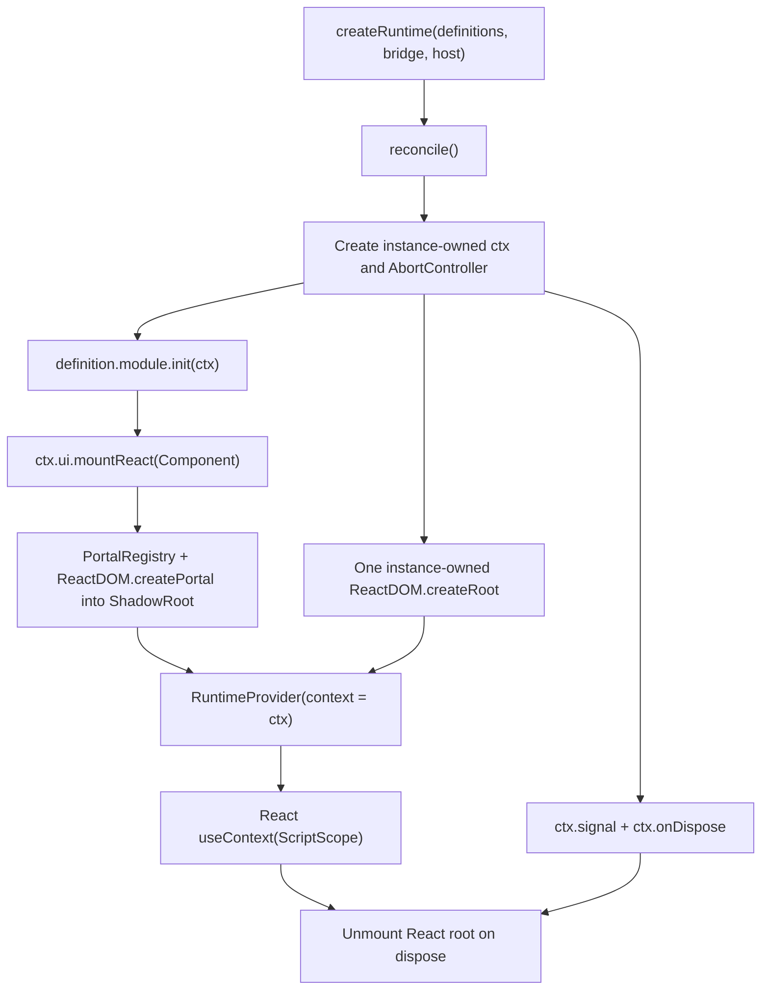

> **TEST SCOPE (2026-11-19):** [docs/testing-policy.md](testing-policy.md) is authoritative. No component, UI, or individual userscript tests. Only runtime and utility tests are retained; typechecks and builds remain mandatory.\n\n# React-only refactor: migration contract

Status: React-only hard cutover authorized 2026-11-18. No Solid dependencies, JSX runtime, compatibility layer or parity requirement. Broken builds accepted until migration is complete.

**Architecture update (2026-11-18):** [Single-root + portals ADR](react-single-root-portals.md) is authoritative for root ownership. One `createRoot()` per runtime instance; `createPortal()` for every independently placed UI target. Older per-mount-root wording below is superseded.

## Non-negotiable target

- React + React DOM + TypeScript for every interactive userscript and shared UI.
- Keep CSS Modules, Shadow DOM isolation, mobile Safari compatibility and the existing shadcn/Vercel visual language.
- Preserve instance-owned `ctx`: `ctx.dom`, `ctx.events`, `ctx.storage`, `ctx.http`, `ctx.ui`, `ctx.signal`, and `ctx.onDispose`.
- `RuntimeProvider` must use the existing `src/core/runtime-context-react.tsx` and must never use a mutable global active context.
- Mount one root per runtime instance via `createRoot` from `react-dom/client`; mount UI targets via `createPortal` from `react-dom`; unmount the owned root on `ctx.onDispose`. Expose `ctx.ui.mount` and transitional `ctx.ui.mountReact`, not `mountSolid`.
- `ctx.store` must be framework-neutral and subscribe through `useSyncExternalStore` or an equivalent React adapter. Do not call React hooks outside React components/custom hooks.
- No direct `document.querySelector`, `addEventListener`, raw fetch/XHR interception, or ad hoc global CSS in migrated feature modules when the equivalent `ctx` API exists.

## Migration order

- [x] Add React 19, React DOM, JSX runtime, typings, compiler configuration, and lockfile changes. Validation of the current integrated branch remains pending.
- [ ] Implement `runtime-react`, React ShadowRoot mount, `ctx.ui.mountReact`, context lifecycle tests, and React-only bundle smoke tests.
- [ ] Migrate shared UI primitives: Button, Badge, Dialog, Dropdown, Toast, RodMenu, Dock, clipboard, object inspector, form controls.
- [ ] Migrate Instagram bookmark UI and settings.
- [ ] Migrate Reddit/GoneWild (including audio, player, search, and Soundgasm) without changing page-world behavior.
- [ ] Migrate RodX Studio and Twitter/X UI, retaining interceptors and mobile gesture behavior.
- [ ] Migrate DOM inspector, page REPL, GitHub tools, mobile editor, and remaining user interfaces.
- [x] Retire the legacy Solid form-controls playground; `/playground/form-controls.html` redirects to the React Rod UI Studio. `playground/instagram-bookmark-app.tsx` is also React 19. No Solid playground entrypoints remain.
- [x] Remove dead Solid-only adapters, `build/solid-dom.mjs`, obsolete Solid context test, unused `rod-libraries.js` facade, and the feature-branch-only form-controls sync workflow. No Solid runtime dependency remains in `package.json`. Remaining audit: classify framework-neutral utilities and historical naming under `src/runtime/solid-ui/`.
- [ ] Enforce CI rule preventing new Solid imports and verify standalone/unified builds and Safari behavior.

## Verification gates

Every migrated vertical must pass TypeScript, applicable runtime/utility tests only, bundle build, context isolation/disposal checks, and manual Safari smoke testing before replacing its production entrypoint. Full removal is complete only when a repository-wide import audit reports zero Solid references and release CI passes.

## Runtime context lifecycle (target)

This document is the target architecture, not a claim that production already uses React.

## Mandatory UI component policy (React migration)

**All new or migrated UI must use official shadcn/ui components or Radix UI primitives.** Do not implement proprietary replacements for buttons, dialogs, menus, dropdowns, selects, comboboxes, tooltips, popovers, tabs, switches, toasts, or form controls. Prefer shadcn's maintained source components and Radix accessibility behavior; compose them for feature-specific screens rather than building a parallel component library.

- React is the only target UI framework. Solid implementations are transitional legacy code, never a template for new features.
- Use shadcn/ui design tokens, Tailwind CSS, and lucide-react icons. Keep the existing visual language and iPhone Safari ergonomics.
- Custom code is allowed only for domain-specific UI composition and the userscript runtime adapters (ctx, ShadowRoot, events, storage, HTTP, lifecycle).
- Any vendored shadcn component must identify its upstream origin and remain close to the official implementation; avoid custom forks of Radix primitives.
- Every UI PR/commit must audit new components against this policy and remove obsolete custom counterparts as each feature migrates.
- Maintain React root lifecycle through ctx.ui.mountReact and dispose via ctx.onDispose. Avoid global CSS leakage into host pages.
